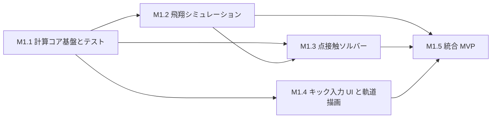

# 03 ロードマップ

> 状態：暫定案（2026-10-18）。本書は Phase・マイルストーン・成熟度定義の正本です。工程の細部や順序は見直してよく、見直した場合は本書を更新します。

## 1. 方針

- 進捗を **物理モデルの成熟度（PM）** と **機能 UI の成熟度（UM）** の 2 軸で管理する。両者は独立に進めてよく、一方の進捗で他方の成熟を主張しない。
- 各モデルには **検証状態** を付ける（§2.3）。「実装した」ことと「実物を再現している」ことを区別する。
- Phase 1 は KickDynamics Lab の MVP。Phase 5 で FootBallistics（候補名）などのゲームへ展開する。

## 2. 成熟度の定義

### 2.1 物理モデルの成熟度（PM）

| レベル | 内容 | 主な Phase |
|---|---|---|
| PM-0 | 物理モデルなし | — |
| PM-1 | 瞬間点接触・剛体（有限質量の足 ＋ 無限質量の比較モデル）、点質量的な空力（抗力・マグヌス・回転減衰）、衝撃モデルによる接地 | 1 |
| PM-2 | 有限時間接触・簡易変形（接触力・接触時間・ボール変形の時間発展） | 2 |
| PM-3 | 面接触・足形状（接触領域、圧力・せん断分布、滑り／固着） | 3 |
| PM-4 | 関節拘束付きの脚、ボール構造、詳細空力、高精度な変形・接触モデル | 4 |

### 2.2 機能 UI の成熟度（UM）

| レベル | 内容 |
|---|---|
| UM-0 | UI なし（テスト・スクリプトのみ） |
| UM-1 | 数値入力フォームと基本的な 3D 表示、軌道の再生 |
| UM-2 | 直接操作（接触点のポインティング、足姿勢の操作）、スローモーション・リプレイ、測定値・診断表示 |
| UM-3 | 解析 UI（複数結果の比較、時系列グラフ、パラメータスイープの可視化） |
| UM-4 | ゲーム向け UI（ゲームモード、演出、チュートリアル） |

### 2.3 検証状態

| 状態 | 意味 |
|---|---|
| 未検証 | 実装または文書のみ。検証していない |
| 実装検証済み | [06](06-validation.md) の該当 VER 項目（解析解・保存則・収束など）に合格 |
| 実測照合済み | 該当 VAL 項目について実測データと比較し、結果と不確かさを記録した（一致したことを意味しない） |

## 3. Phase の概要

| Phase | 目標 | 主な成果物 | 完了条件（概要） | 依存 |
|---|---|---|---|---|
| 1 | 点接触・瞬間衝突・剛体モデルのブラウザ MVP | Core（接触・飛翔・接地）、Lab（入力・3D 表示・再生・測定値）、VER テスト | [spec.md](../specs/001-kick-prototype/spec.md) の AC を満たし、Phase 1 の VER に合格。モデルは「実装検証済み・実測未照合」と明記 | — |
| 2 | 有限時間接触と簡易変形 | 時間発展型の接触ソルバー、接触時間・力履歴・変形の出力と可視化 | 剛体極限で瞬間衝突モデルと整合（VER）。接触時間・力の実測照合を実施または未実施を明記 | 1 |
| 3 | 面接触と足形状 | 足甲・内側・外側などの形状モデル、接触領域・圧力分布、滑り／固着 | キック種別の違いが入力条件（形状・姿勢・軌道）の違いから生じる（種別ごとの補正なし）。定量的妥当性は VAL で評価 | 1（2 と相互依存、§5） |
| 4 | 高精度化と実測検証 | 関節拘束、ボール構造、詳細空力、高精度な変形・接触 | 主要量（初速・回転・軌道・接触時間など）を実測と定量比較し、不確かさとともに報告 | 2, 3 |
| 5 | ゲーム化 | 共通 Core を使ったゲーム（候補名 FootBallistics）の操作性・モーション・ルール・モード | 物理シミュレーションの結果が Lab と同一であることを回帰テストで確認。ゲーム側の調整は Core 外 | 1 以降（§6） |

## 4. Phase 1 のマイルストーン

M1.3 の地面バウンドは M1.2 の地面交差イベント検出を使うため、M1.2 → M1.3 の依存がある。M1.4 は M1.1 の型定義があればスタブデータで並行して進められる。

| マイルストーン | 成果物 | 完了条件 | 依存 | 到達成熟度 |
|---|---|---|---|---|
| M1.1 描画非依存の計算コア基盤とテスト | ワークスペース構成、`packages/physics-core` 雛形、ベクトル・行列・四元数演算、状態・パラメータ型、依存境界チェック | VER-M01〜M04 に合格。Core が DOM 型なしで型検査を通り、Node 上でテストが動く。AGENTS.md にコマンドを追記 | 着手前の決定（[tasks.md](../specs/001-kick-prototype/tasks.md) T0） | PM-0 / UM-0 |
| M1.2 飛翔シミュレーション | 重力・抗力・マグヌス・回転減衰（各 ON/OFF）、固定刻み積分、姿勢積分、地面交差イベント、軌道データ、測定値計算 | VER-F01〜F13、VER-S03 に合格 | M1.1 | PM-1（飛翔部分） |
| M1.3 点接触ソルバー | 衝撃ベースの接触ソルバー（有限質量・無限質量、固着／滑り）、衝突診断、入力からの接触幾何構築、地面バウンド、転がり・停止（目標） | VER-C01〜C18、VER-G01〜G02 に合格（転がりを実装した場合は G03〜G06 も） | M1.1, M1.2 | PM-1 |
| M1.4 ブラウザのキック入力 UI と軌道描画 | `apps/web` 雛形、3D シーン、Core ↔ Three.js アダプタ、接触点ピッキング、足条件の入力、パラメータ表示、スタブ軌道の描画 | spec の AC-01〜AC-04、AC-13 を満たす（AC-13 はスタブ値で可） | M1.1 | UM-1〜UM-2 |
| M1.5 統合 MVP・軌道再生・測定値表示・検証 | `simulateKick` パイプライン、UI 結線、再生コントローラ、測定値・診断表示、出力、検証レポート、静的配信 | spec の全 AC を満たす。検証レポートに VER 結果と VAL の状態を記載。文書（05 パラメータ表、06 状態、README）を更新 | M1.2, M1.3, M1.4 | PM-1 / UM-2 |

詳細な作業分解は [plan.md](../specs/001-kick-prototype/plan.md) と [tasks.md](../specs/001-kick-prototype/tasks.md) を参照。

## 5. Phase 2 と Phase 3 の順序について

接触の変形（Phase 2）と面接触（Phase 3）は技術的に相互依存する。例えば、面接触の接触領域は変形量に依存し、変形モデルは接触領域の形状に依存する。そのため Phase 2 → 3 の順序は**暫定**であり、Phase 1 完了時点で次のいずれかを選ぶ（未決定）。

- 案 A：Phase 2（球の簡易変形 ＋ 点接触近似の時間発展）を先に行い、その後に面接触へ拡張する。
- 案 B：足形状と剛体面接触（瞬間）を先に行い、その後に時間発展・変形を加える。
- 案 C：簡易な時間発展と簡易な面接触を同時に導入する。

判断材料：実装難度、検証方法の有無（実測データの入手性）、Phase 1 で見つかった限界。

## 6. 成熟度の推移予定

| 時点 | PM | UM | 検証状態（目標） |
|---|---|---|---|
| Phase 1 完了 | PM-1 | UM-2 | 実装検証済み（VAL は入手データ次第。未実施なら明記） |
| Phase 2 完了 | PM-2 | UM-2〜3 | 実装検証済み、接触時間・力は可能なら実測照合 |
| Phase 3 完了 | PM-3 | UM-3 | 同上 |
| Phase 4 完了 | PM-4 | UM-3 | 主要量の実測照合済み |
| Phase 5 | PM-1 以上（ゲームが使う Core の版による） | UM-4 | ゲーム側の変更が Core の結果を変えないことの回帰テスト |

ゲームの操作性の試作（UM-4 の一部）を物理成熟度と独立に前倒しする余地は残す（未決定）。

## 7. 見直しのトリガー

次の場合に本書を見直す。

- 性能計測で TypeScript 実装の限界が見えた（Rust/WASM 等の検討、[ADR-0002](decisions/0002-independent-physics-core.md)）
- 実測データとの比較で、モデルの限界が想定より早く支配的になった
- UI 試作で入力自由度（[OQ-03](research/references-and-open-questions.md)）の見直しが必要になった
- Phase 2 / 3 の順序を決定するとき（§5）
