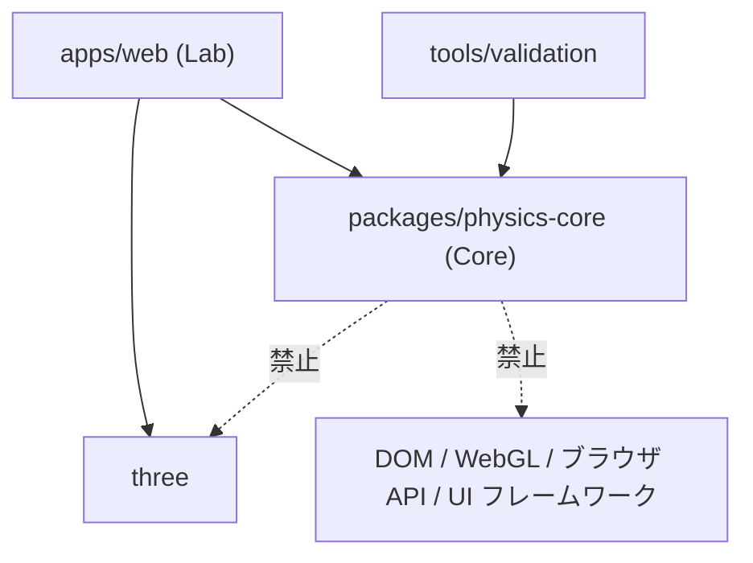
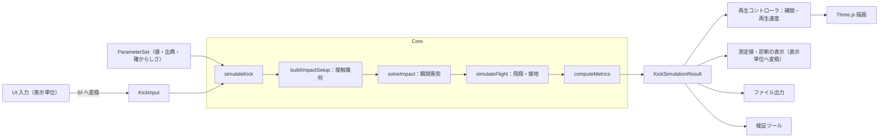

# 04 アーキテクチャ

> 状態：初版・草案（2026-10-18）。本書はアーキテクチャ・パッケージ構成・依存ルール・Core API 草案の正本です。数式は [05-physics-model.md](05-physics-model.md) を参照し、ここには複製しません。

## 1. 原則

1. **Core の独立**：物理計算（KickDynamics Core）は描画・UI・ブラウザ API から独立した純粋な計算モジュールとする（[ADR-0002](decisions/0002-independent-physics-core.md)）。
2. **素のデータで受け渡す**：Core の入出力は、シリアライズ可能な素のデータ（数値・配列・プレーンオブジェクト）とする。
3. **事前計算と再生**：Phase 1 ではキック 1 回分の軌道を Core で事前計算し、Lab はそれを再生する。
4. **物理時間と描画時間の分離**：物理の時間刻みは固定で、描画 FPS や再生速度に依存しない。
5. **差し替え可能性**：接触ソルバー・空力モデル・積分法はインタフェース越しに差し替えられるようにし、将来の Phase の拡張や WASM 実装への置換を妨げない。

## 2. 構成要素と責務

| 構成要素 | 場所 | 責務 | 持たない責務 |
|---|---|---|---|
| KickDynamics Core（仮称） | `packages/physics-core/` | 剛体状態、接触ソルバー、飛翔・接地の時間積分、測定値計算、診断値、パラメータセットの型 | 描画、DOM、入力イベント、表示単位への変換、Three.js 型 |
| KickDynamics Lab（仮称） | `apps/web/` | 3D 描画（Three.js）、入力 UI、表示単位への変換、Core 型 ↔ Three.js 型の変換、再生（補間・再生速度）、結果の出力 | 物理計算、物理的な補正 |
| 検証ツール（候補） | `tools/validation/` | 検証シナリオの実行、パラメータスイープ、検証レポートの生成、（将来）実測データとの比較 | 描画、UI |

検証ツールを独立パッケージにするか、Core のテストと Node スクリプトで十分かは未決定（M1.5 で判断）。

## 3. パッケージ構造案

```text
apps/web/                     # KickDynamics Lab
  index.html
  src/
    main.ts                   # 起動
    render/                   # Three.js のシーン・メッシュ・カメラ
    ui/                       # 入力パネル、パラメータパネル、結果パネル
    adapters/                 # Core 型 ↔ Three.js 型の変換（座標系の対応を含む）
    units/                    # 表示単位への変換（km/h、rpm、度）
    playback/                 # 再生クロック、補間、再生速度、リプレイ
packages/physics-core/        # KickDynamics Core
  src/
    math/                     # Vec3、Mat3、Quat
    bodies/                   # 剛体状態、慣性テンソル、力学量（運動量・エネルギー）
    contact/                  # 衝撃ベースの接触ソルバー、接触幾何
    flight/                   # 力モデル（重力・抗力・マグヌス・回転減衰）、積分器
    ground/                   # 地面イベント、バウンド、転がり
    simulation/               # 接触 → 飛翔 → 接地のパイプライン
    metrics/                  # 測定値の計算
    params/                   # パラメータセット（値・出典・確からしさ）
    index.ts                  # 公開 API
  test/                       # VER 項目のテスト
tools/validation/             # 候補：検証スクリプトとレポート生成
```

- ワークスペースは **npm workspaces** で管理する（決定：[ADR-0004](decisions/0004-npm-workspaces-and-initial-dependencies.md)、OQ-16）。ルートの `package.json` に `"workspaces": ["apps/*", "packages/*"]` を置き、`package-lock.json` をコミットする。承認済みの依存パッケージも ADR-0004 を参照。
- パッケージ名：Core は `@kick-dynamics/physics-core`（暫定、T1.1-02）。Core の `exports` はビルドせずに `src/index.ts` を指す（Lab は Vite で、テストは Vitest で直接 TypeScript を読む）。

## 4. 依存ルール



- Core は他のワークスペースパッケージにも外部パッケージにも依存しない（ランタイム依存ゼロが原則。開発依存は TypeScript とテストランナーのみを想定）。
- 強制方法（候補）：
  - Core の `tsconfig` の `lib` に `DOM` を含めない（DOM の型を使うと型検査で失敗する）。
  - Core の `package.json` に `dependencies` を持たない。
  - import 文の検査（lint ルール、または簡単なスクリプト）。lint ツールの導入は依存の追加にあたるため、採否はユーザーの承認後に決める。
- 採用した強制方法（T1.1-03）：上記の `lib`・`dependencies` に加え、依存を追加しないスクリプト `packages/physics-core/scripts/check-boundary.mjs`（`npm run check:boundary`）で、`src/` の import 指定子が相対パスだけであることを検査する（`three`、`node:` 組み込みモジュールなど外部への参照をすべて禁止）。

## 5. データフロー



## 6. Core 公開 API 草案

> **草案**。名前と細部は M1.1 で確定する。以下は方針を示すための型スケッチであり、実装ではない。
> データ表現は決定済み（OQ-15、2026-10-18）：API の `Vec3`・`Quat`・`Mat3` は readonly のタプル、時系列の `Trajectory` は `Float64Array`。積分ループ内部の表現は、計測で必要と分かった場合に限って最適化する（API の形は変えない）。

```ts
type Vec3 = readonly [number, number, number];
type Quat = readonly [number, number, number, number]; // [x, y, z, w]（ADR-0005）
type Mat3 = readonly [number, number, number, number, number, number, number, number, number]; // 行優先：要素 (i, j) は m[3 * i + j]（決定、T1.1-05）

interface RigidBodyState {
  position: Vec3;        // m（ワールド座標、重心）
  orientation: Quat;     // 物体座標 → ワールド座標の回転
  linearVelocity: Vec3;  // m/s
  angularVelocity: Vec3; // rad/s（ワールド座標で表す）
}

interface BallParams { mass: number; radius: number; inertiaCoefficient: number } // 05 §5.1
interface FootParams { mass: number; inertiaBody: Mat3; shape: FootShape }       // 05 §5.2
type FootShape = { kind: 'box'; dimensions: Vec3 }; // [L_x, L_y, L_z] m。接触面は +z_b 面（05 §5.2）

type FootModel = 'finite-mass' | 'kinematic-wall';

// UI の入力を物理的に整合した衝突直前状態へ変換する前の入力。各項目の定義は 05 §6.2 の表。
interface KickInput {
  contactDirection: Vec3;              // d：ボール中心 → 接触点の単位ベクトル
  footRollAboutNormal: number;         // φ：接触法線まわりの足の回転角 rad
  footContactLocation: readonly [number, number]; // (s_x, s_y)：接触面上の接触位置 m
  footContactPointVelocity: Vec3;      // v_A^p：接触点での足の速度 m/s
  footAngularVelocity: Vec3;           // ω_A：rad/s（既定 0）
  footModel: FootModel;
}

interface ImpactSetup {        // 物理的に整合した衝突直前状態（05 §6.2）
  ball: RigidBodyState;
  foot: RigidBodyState;
  contactPoint: Vec3;
  contactNormal: Vec3;         // 足 → ボール
}

interface ImpactResult {
  impulse: Vec3;               // ボールに加わる衝撃量 N·s
  regime: 'separating' | 'stick' | 'slide';
  ballAfter: RigidBodyState;
  footAfter: RigidBodyState;
  diagnostics: ImpactDiagnostics; // 運動エネルギー・運動量・角運動量の前後、警告
}

interface Trajectory {         // 構造体の配列ではなく、配列の構造体（WASM・Worker 転送向き）
  time: Float64Array;          // s
  position: Float64Array;      // 3N
  linearVelocity: Float64Array;   // 3N
  orientation: Float64Array;   // 4N
  angularVelocity: Float64Array;  // 3N
  events: SimEvent[];          // impact / ground-contact / roll-start / stop / max-time など
}

interface KickSimulationResult {
  modelVersion: string;
  input: KickInput;
  parameters: ParameterSet;    // 値・単位・出典・確からしさ（05 §10）
  settings: SimulationSettings; // 時間刻み・最大時間・サンプリング間隔
  impact: ImpactResult;
  trajectory: Trajectory;
  metrics: KickMetrics;        // 05 §9
  warnings: SimWarning[];
}

// 一括 API（Lab が使う）
declare function simulateKick(
  input: KickInput, parameters: ParameterSet, settings: SimulationSettings,
): SimResult<KickSimulationResult>;

// 段階 API（テスト・検証ツールが使う）
declare function buildImpactSetup(input: KickInput, parameters: ParameterSet): SimResult<ImpactSetup>;
declare function solveImpact(setup: ImpactSetup, parameters: ParameterSet, model: FootModel): ImpactResult;
declare function simulateFlight(ball: RigidBodyState, parameters: ParameterSet, settings: SimulationSettings): Trajectory;
declare function computeMetrics(impact: ImpactResult, trajectory: Trajectory, parameters: ParameterSet): KickMetrics;

type SimResult<T> = { ok: true; value: T } | { ok: false; error: SimError };
```

方針：

- 想定内の入力エラー（離反方向の足速度、範囲外のパラメータなど）は例外ではなく `SimResult` のエラー値で返す。プログラムの誤りは例外でよい。
- `ParameterSet` は値とメタデータ（単位・出典・確からしさ・適用条件）を持つ。Core の計算は値のみを使い、メタデータはそのまま結果に含めて UI と出力へ渡す。
- 各力項の ON/OFF とモデル選択（定数 `C_D` か関数かなど）は `SimulationSettings` 側（`FlightForceSettings`）に置き、物理定数（$g$、$\rho$、$\eta$、風速）は `FlightEnvironment` として渡す。どちらもパイプライン（T1.5-01）で `ParameterSet` の値から組み立てる（暫定、T1.2-01、`packages/physics-core/src/flight/types.ts`）。
- 空力係数を関数で与える場合、関数は $(Re, S)$ を受け取り、有限の値を返す。$C_D$・$C_M$ は非負、$C_L$ の符号は [05 §7.4](05-physics-model.md) の規約に従う。関数が範囲外の値・NaN・無限大を返した場合や、入力が係数の定義域外の場合は、値を補正・切り詰めせずに `SimResult` のエラーとして返す。

## 7. 物理時間と描画時間

| 項目 | 物理（Core） | 描画（Lab） |
|---|---|---|
| 時間刻み | 固定 `Δt`（値は収束試験で決める、[OQ-12](research/references-and-open-questions.md)） | `requestAnimationFrame` の可変フレーム間隔 |
| 実行 | キック実行時に終了条件まで一括計算 | 計算結果を再生 |
| 再生速度 | 影響しない | 再生クロック `t_play += Δt_frame × 再生速度` |
| 補間 | — | 位置：線形補間、または速度を使うエルミート補間（候補）。姿勢：球面線形補間 |

- スローモーション・リプレイは再生クロックの操作だけで実現し、再計算しない。
- Phase 1 の衝突は瞬間的なため、衝突の瞬間に「接触している時間」は存在しない。衝突前の足の接近アニメーションを表示する場合、それは**演出であり物理計算に影響しない**ことを UI で区別する（表示方法は未決定）。
- 計算をメインスレッドで行うか Web Worker で行うかは、計測後に決める（[OQ-18](research/references-and-open-questions.md)）。`Trajectory` を型付き配列にしておくと Worker からの転送が容易になる。
- 将来のゲームでリアルタイムに逐次計算する場合は、固定刻みのアキュムレータ方式（描画フレームごとに必要な数だけ固定刻みで進める）を候補とする。

## 8. 座標系と単位の境界

- Core の座標系・単位系は [05 §1–2](05-physics-model.md) を正本とする。
- Core と Three.js の座標系が一致する場合でも、変換は必ず `apps/web/src/adapters/` を通す。座標系の変更や符号の誤りを 1 か所で扱うため。
- 表示単位への変換は `apps/web/src/units/` に限定し、Core には持ち込まない。

## 9. WASM 等への置換を妨げないための方針

1. 公開 API は素のデータのみを受け渡し、メソッドを持つクラスのインスタンスを境界に出さない。
2. 呼び出しは粗い粒度にする（1 キックにつき 1 回。ステップごとの呼び出しや、Core から JS へのコールバックを境界に置かない）。
3. 数値はすべて倍精度浮動小数点数（f64）とし、大きな時系列は型付き配列で返す。
4. Core は純粋関数を基本とし、グローバルな可変状態を持たない。
5. 入力とその期待出力の組（ゴールデンデータ、JSON）を保存し、別実装（WASM 等）を同じデータで検証できるようにする。
6. TypeScript 特有の機能（`Map` などの JS 固有オブジェクト）を API の型に使わない。

Rust/WASM への移行は決定していない。移行するかどうかは、性能計測の結果をもとに ADR で判断する。

## 10. 決定性と再現性

- Core では `Math.random`、現在時刻、環境依存の状態を使わない。
- 同一環境・同一入力では同一結果を返す（NFR-05）。`Math.sin` などの初等関数は JS エンジン間で末尾の桁が異なりうるため、異なるブラウザ間のビット単位の一致は保証しない。テストは許容誤差付きで比較する（[06](06-validation.md)）。
- 結果に `modelVersion`、パラメータ一式、設定を含め、出力ファイルから再計算できるようにする（NFR-06）。

## 11. 開発ワークフローとの関係

- 開発は Claude Code（主担当）と Codex（独立検証担当）が分担し、人間が最終判断を行う（役割は [AGENTS.md](../AGENTS.md)、手順は [06 §9](06-validation.md)）。
- 独立検証の記録は `verification/independent/`（予定）に置き、Core のテスト（`packages/physics-core/test/`）とは分ける。独立検証のために Core の構造を変える必要はないが、§6 の段階 API（`buildImpactSetup`、`solveImpact`、`simulateFlight`、`computeMetrics`）を公開しておくことで、機能ごとの照合がしやすくなる。

```text
verification/                 # 予定（未作成）
  independent/
    IV-01/                    # 導出資料・照合結果・差異の解決記録（形式は未決定）
    ...
```

## 12. 未決定事項

OQ-12（積分法・刻み）、OQ-17（UI ライブラリ）、OQ-18（実行スレッド）、OQ-19（出力形式）。OQ-11（座標系）、OQ-15（データ表現）、OQ-16（ワークスペース）は決定済み。詳細は [research/references-and-open-questions.md](research/references-and-open-questions.md)。
