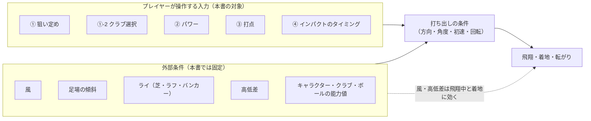
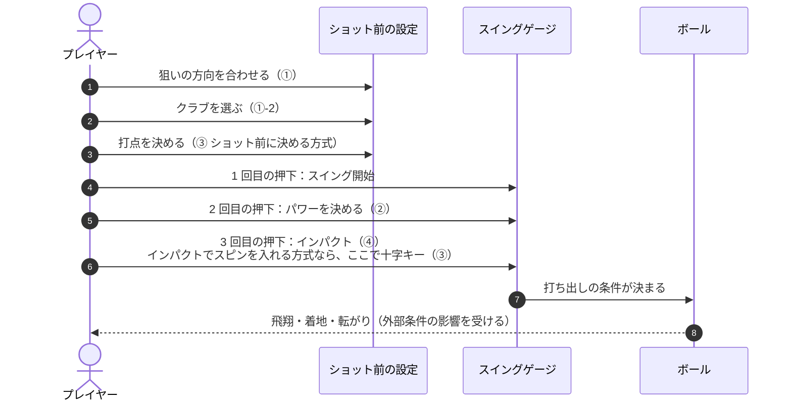
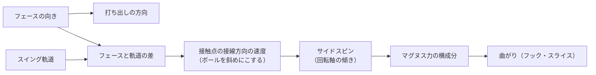
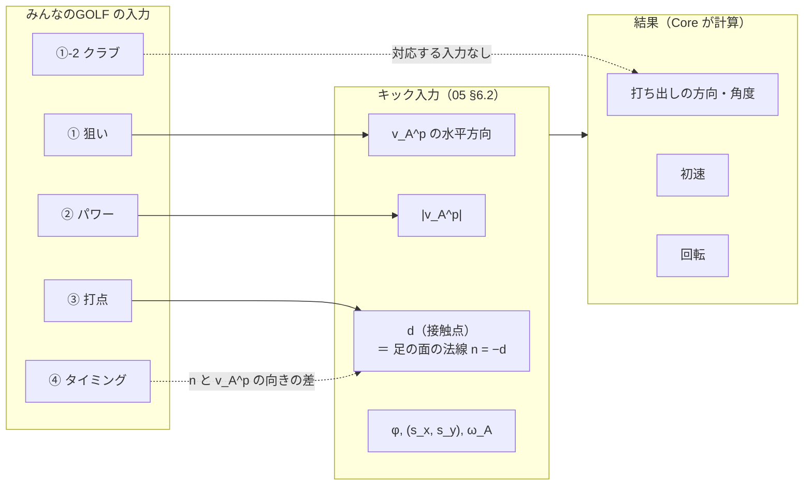

# R-13 調査メモ：ゴルフゲームのショット UI（みんなのGOLF）とキック入力への対応

> 状態：調査メモ・初版（2026-11-15）。**正本ではない。** 調査テーマ [R-13](references-and-open-questions.md)（類似のシミュレータ・ゲームの UI と機能。UI の参考であり複製はしない）の参考資料。物理モデル・入力の定義の正本は [05](../05-physics-model.md)、受入条件は [spec](../../specs/001-kick-prototype/spec.md)。本書の内容は、どの仕様の決定にもなっていない。

## 1. 目的

- ゴルフゲーム『みんなのGOLF』シリーズの「従来ショット」（コンソール版）を例に、**ボールの軌道を決める要素**と、**それを入力するための操作・UI** を分解する。
- その分解を KickDynamics のキック入力（[05 §6.2](../05-physics-model.md)）に対応づけ、シミュレータ、将来のゲーム化での入力 UI の参考にする。
- ゲームの画面・名称・演出の複製はしない。参考にするのは「操作をどの順で、どの自由度に割り当てるか」という構造だけにする。

## 2. 情報の確からしさ

| 区分 | 内容 |
|---|---|
| 出典で確認 | §8 の 2 件の記事に書かれていること（各所に [S1]、[S2] で示す） |
| ユーザーの観察 | ショットの流れが分かる動画（YouTube）を見たユーザーの観察。本書の作成者（Claude Code）は動画を見ていない |
| 推定 | 操作と挙動を外から見た分解。ゲーム内部の計算方法、乱数によるぶれの有無は**未確認** |
| 一般的なゴルフの理解 | §5 の「フェースの向き」と「スイング軌道」の説明。**出典未確認**（R-13 の範囲外。必要になったら文献で確認する） |

シリーズの作品ごとに操作の割り当てが違う。[S1] は PS4 版『New みんなのGOLF』（海外名 *Everybody's Golf*、2017）、[S2] は『みんなのGOLF WORLD』（2025）についての記事。

## 3. 範囲：操作する入力と外部条件

1 回のショットで軌道を決めるものを、**プレイヤーが操作する入力**と**外部条件**に分ける。本書は操作する入力だけを扱い、外部条件は固定された前提とする。



外部条件について、出典で確認できたこと：

- 風の向きは画面の右上に表示され、バックスピンの球は滞空が長いぶん風の影響を受けやすい [S1]。
- フェアウェイの外に落ちるとショットのパワーが下がり、その割合が右下の表示に出る [S1]。
- パワーバーの上の線が地形の起伏を示す [S1]。

## 4. 軌道を決める要素（みんなのGOLF の場合）

### 4.1 要素の一覧

| # | 入力 | 決まるもの | 操作 | 確からしさ |
|---|---|---|---|---|
| ① | 狙い定め | 左右の打ち出し方向 | ショット前に、狙いの方向を左右に回す | ユーザーの観察 |
| ①-2 | クラブ選択 | 上下の打ち出し角、最大飛距離、スピンのかかりやすさ | ショット前に、クラブを切り替える | 推定（クラブの性質は一般的なゴルフの理解） |
| ② | パワー | 初速（飛距離） | スイングゲージの 2 回目の押下 | [S1]、[S2] |
| ③ | 打点 | 回転の向きと量（上下：トップスピン／バックスピン、左右：サイドスピン） | 十字キー。ショット前に決める方式と、インパクトの瞬間に入れる方式がある | [S1]、[S2]、ユーザーの観察 |
| ④ | インパクトのタイミング | 正確なら狙いどおり。ずれると方向がずれ、フックやスライスがかかる | スイングゲージの 3 回目の押下 | ユーザーの観察（ずれたときの曲がり）、[S1]（スーパースピンには正確なインパクトが必要） |

③ について出典で確認できたこと：

- インパクト（3 回目の押下）で十字キーの下を押すとバックスピンになり、弾道が高くなる。上を押すとトップスピンになり、弾道が低くなる。左右ではサイドスピンがかかる [S1]。
- [S1] は「左へフックさせたいなら右を押す（逆も同じ）」と書いている。入力の向きと曲がる向きが逆になる。ユーザーが動画で見た右下のボール上のカーソルでも同じ対応になっているかは**未確認**。
- パワーを決める押下（2 回目）で十字キーを入れ、インパクトでも対応する入力をすると「スーパーバックスピン」などになる。インパクトが正確でないと発生しない [S1]。
- 『WORLD』では、ショット前にスピンを決められる操作タイプが追加された。従来の、ショット中に方向キーでスピンを入れる操作タイプも残っている [S2]。動画で見た「右下のボールの中心にあるカーソルを十字キーで動かす」UI が、ショット前に決める方式にあたると考えられる（推定）。

### 4.2 操作の順序



- 操作を時間で区切り、1 回の操作で 1 つの量を決める構造になっている（推定）。
- ①〜③ は時間の制約がない（じっくり決める）。②・④ はタイミングの技量を問う。

### 4.3 画面の構成（模式図）

実際の画面の写しではない。どこに何の情報があるかだけを示す。

```text
┌─────────────────────────────────────────────┐
│ クラブ・残り距離                       風の向き・強さ │
│                                               │
│                 ╲ 狙いのライン                 │
│                  ╲    ◎ 落下予想地点          │
│                   ╲                          │
│                    ○ ボール                   │
│                                      ┌─────┐  │
│                                      │  ●  │  │ ← 打点（ボールの絵と
│                                      │ ╋   │  │    十字キーで動くカーソル）
│  ├────────────────┼──────┤│ │         └─────┘  │
│  スイングゲージ    ↑パワー  ↑インパクトの枠       │
└─────────────────────────────────────────────┘
```

- 打点はボールの絵の上のカーソルで示す。カーソルが中心から上下左右にどれだけ離れているかで、回転の向きと量が分かる。
- スイングゲージは 1 本のバーで、パワー（どこまで振り上げるか）とインパクト（戻ってきた位置）を順に決める。インパクトの枠から左右にずれると、ずれたことが分かる。

## 5. 物理的な解釈（ゴルフ）

ゲームの操作を、実際のゴルフの物理に当てはめるとこうなる。**一般的なゴルフの理解であり、出典は未確認**。

| ゲームの入力 | 実際のゴルフでの対応 |
|---|---|
| ① 狙い定め | 構えの向き。スイング軌道とフェースの基準になる向き |
| ①-2 クラブ選択 | フェースの傾き（ロフト角）と、クラブの長さによるヘッド速度の違い。ロフト角が大きいほど高く上がり、バックスピンが増える |
| ② パワー | ヘッドの速さ |
| ③ 打点 | ボールのどこに当てるか。上下で打ち出し角とバックスピン量、左右でサイドスピン |
| ④ タイミング | インパクトでの**フェースの向き**。打ち出しの方向は主にフェースの向きで決まり、曲がり方は**フェースの向きとスイング軌道の差**で決まる。この差がサイドスピンを生む。タイミングの早い・遅いを「フェースが閉じた・開いた」と見なすと筋が通る |

ゲームは、これらの物理を**独立した 5 つのつまみ**として切り出している。そのため操作は分かりやすいが、実際には打点・フェースの向き・スイング軌道は互いに独立していない。

### 5.1 打ち出し方向と曲がりの区別

左右の軌道は、**打ち出しの方向**と**曲がり**の 2 つに分けて考える。両者は別々の量で決まる（一般的なゴルフの理解。出典未確認）。

| 決まるもの | 主に決めるもの |
|---|---|
| 打ち出しの方向 | インパクトでのフェースの向き |
| 曲がりの向きと量 | フェースの向きとスイング軌道の差（フェース・トゥ・パス） |

右打ちの場合：

- フェースが軌道に対して**閉じている**（左を向いている）と、回転軸が左に傾き、左へ曲がる。差が小さければドロー、大きければフック。
- フェースが軌道に対して**開いている**と、右へ曲がる。差が小さければフェード、大きければスライス。
- フェースと軌道が揃っていれば、曲がらない。



- フェースの向きと軌道の差の組み合わせで、「右に出て右へ曲がる（プッシュスライス）」「左に出て右へ曲がる（引っかけてからスライス）」のように、打ち出しと曲がりがそれぞれ別に変わる。
- ほかに、面がふくらんだクラブ（ドライバーなど）では、フェースの先や根元で打つとヘッドがねじれ、横回転が加わる（ギア効果）。
- 回転が生まれる仕組みは、フェースがボールを斜めにこすりながら押すことで、接触点に接線方向の速度が生じ、摩擦で回転になること。キックの接触モデル（[05 §6.7](../05-physics-model.md) の摩擦）が扱うのと同じ構造である。

### 5.2 ゲームの入力の解釈（推定）

上の区別を使うと、ゲームの入力は次のように解釈できる。ゲーム内部で実際にこう計算しているかは**未確認**。

| ゲームの入力 | 解釈 |
|---|---|
| ① 狙い定め | スイング軌道とフェースの基準の向きを、両方まとめて決める |
| ③ 打点の左右 | フェースと軌道の差を**意図して**作る（狙って曲げる） |
| ④ タイミングのずれ | 軌道はそのままで、フェースの向きだけがずれる。打ち出し方向のずれと曲がりが同時に起きる（失敗して曲がる） |

- 曲がりの元は、③ も ④ も**同じ物理量（フェースと軌道の差）**である。ゲームはそれを、意図した入力（③）と技量によるぶれ（④）の 2 つに分けている。
- キックでは、この物理量は足の面の法線 $\mathbf n$ と足の速度 $\mathbf v_A^p$ の向きの差にあたる（§6.2）。

## 6. KickDynamics のキック入力への対応

### 6.1 対応表

キック入力の定義は [05 §6.2](../05-physics-model.md) にある（接触方向 $\mathbf d$、法線まわりの回転角 $\phi$、接触面上の接触位置 $(s_x, s_y)$、接触点での足の速度 $\mathbf v_A^p$、足の角速度 $\boldsymbol\omega_A$）。

| みんなのGOLF | キック入力で対応するもの | 注意点 |
|---|---|---|
| ① 狙い定め | $\mathbf v_A^p$ の水平方向 | |
| ①-2 クラブ選択 | 対応する入力はない。打ち出し角は、$\mathbf d$ の上下成分と $\mathbf v_A^p$ の上下成分から**結果として**決まる | 打ち出し角を直接指定する操作を主操作にしない（[AGENTS.md](../../AGENTS.md) ルール 3） |
| ② パワー | $\lvert\mathbf v_A^p\rvert$（足の速さ） | |
| ③ 打点 | $\mathbf d$（ボール上の接触点） | 回転は、接触点と足の速度から接触モデル（[05 §6](../05-physics-model.md)）で決まる。キック種別やカーソル位置に応じて回転を付け足す処理はしない（ルール 2、[05 §12](../05-physics-model.md)） |
| ④ タイミング（フェースの向き） | 足の面の法線 $\mathbf n$ と $\mathbf v_A^p$ の向きの差 | §6.2 を参照 |
| （対応なし） | $\phi$、$(s_x, s_y)$、$\boldsymbol\omega_A$ | ゴルフのクラブには、足の向きや足のどこで当たるかにあたる自由度がない |



### 6.2 ゴルフと構造が違う点

- **打点と面の向きが一体である。** 05 §6.2 のとおり、ボール上の接触点 $\mathbf d$ を決めると、足の面の向き（法線 $\mathbf n = -\mathbf d$）も決まる。ゴルフゲームでは打点（③）とフェースの向き（④）を別々に入力するが、キック入力では同じ 2 自由度になる。
- **「フェースの向きとスイング軌道の差」は、$\mathbf n$ と $\mathbf v_A^p$ の向きの差にあたる。** 足の速度が面の法線からずれるほど、接触点に接線方向の速度が生じ、摩擦で回転がかかる。曲がる球（カーブ）を蹴る構造は、ゴルフのフックやスライスと同じ形をしている。
- **クラブ選択がない。** ゴルフではクラブがロフト角（＝打ち出し角の目安）を離散的に与える。キックでは、接触点の高さと足の振り上げ方向から打ち出し角が連続的に決まる。ゲーム化で「キックの種類」をクラブのように選ばせる場合でも、それは**入力条件の組のプリセット**（05 §12）にとどめ、出力を補正してはならない。

### 6.3 入力 UI の案（候補・未決定）

ゲームの操作の構造を借りた場合の案。**どれも未決定**で、M1.4 の範囲（[tasks.md](../../specs/001-kick-prototype/tasks.md)）を超えるものは、ユーザーの指示があってから検討する。

| 案 | 操作 | 決まる入力 | ゴルフゲームとの対応 |
|---|---|---|---|
| A | 狙いのラインを水平に回す | $\mathbf v_A^p$ の水平方向 | ① |
| B | ボールの絵の上でカーソルを動かす（十字キー、ドラッグ） | $\mathbf d$ | ③（ショット前に決める方式） |
| C | パワーゲージ | $\lvert\mathbf v_A^p\rvert$ | ② |
| D | インパクトの枠からのずれ | $\mathbf v_A^p$ の向き（または $\mathbf d$）のぶれ | ④。技量の要素として、意図した入力からのずれを作る。ずれの大きさをどう決めるかは未決定 |
| E | 足の振り上げ方向（上下） | $\mathbf v_A^p$ の上下成分 | ①-2 の代わり |

- 現在のシミュレータの入力パネル（T1.4-07）は、各入力をスライダーと数値欄で直接指定する。上の案は、ゲーム化のときの「操作の手順化」の参考であり、シミュレータの入力パネルを置き換える提案ではない。
- 案 D のように技量のぶれを入れる場合、ぶれは**入力の側**に入れ、Core の結果を補正しない（ルール 2）。
- 案 B で回転の量を見せたい場合も、表示するのは「どこに当てるか」までにする。どれだけ回転がかかるかは Core の計算の結果として、蹴ったあとに表示する。

## 7. 未決定事項

- 右下のボール上のカーソルが、[S1] のインパクト時の十字キー入力と同じく「入力の向きと曲がる向きが逆」になっているか（動画の作品で未確認）。
- ゲーム内部で、①〜④ の入力からどう打ち出しの条件を計算しているか。乱数によるぶれがあるか（未確認。KickDynamics の設計には不要な可能性が高い）。
- §6.3 の案を採用するか、採用するならどの Phase で行うか（未決定。ロードマップ [03](../03-roadmap.md) での扱いも未決定）。
- §5 の一般的なゴルフの理解を、出典で確認するか（必要になったら R-13 の文献として追加する）。

## 8. 出典

| ID | 出典 | 確認した内容 |
|---|---|---|
| S1 | Push Square, "Guide: How to Play Like a Pro in Everybody's Golf on PS4", 2017-08. <https://www.pushsquare.com/news/2017/08/guide_how_to_play_like_a_pro_in_everybodys_golf_on_ps4> | スイングゲージの 2 回目・3 回目の押下の役割、インパクトでの十字キーによるスピン、スーパースピン、風・ライ・地形の表示（2026-11-15 に本文を確認） |
| S2 | 電撃オンライン「『みんなのGOLF WORLD』先行プレイ感想。スピンを事前にかけられる新規操作タイプが超快適！」2025-06-05. <https://dengekionline.com/article/202506/42150> | ボタンを 3 回押すショット、ショット前にスピンを決める操作タイプの追加、従来のショット中の方向キー入力（2026-11-15 に本文を確認） |
| — | ユーザーが共有した、ショットの一連の流れが分かる動画（YouTube）。<https://www.youtube.com/watch?v=Xr-TV_lbMr0> | 本書の作成者は未視聴。内容はユーザーの観察として扱う |
