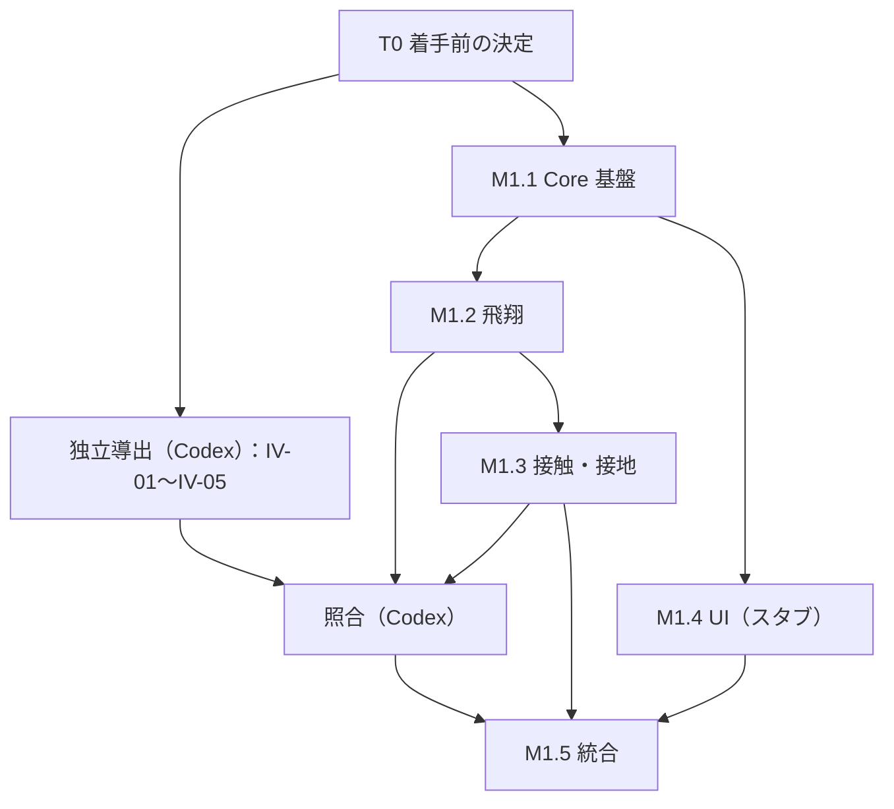

# 001 キックプロトタイプ（Phase 1）実装計画

> 状態：Draft（2026-10-18）。マイルストーンの定義と完了条件は [03-roadmap.md](../../docs/03-roadmap.md) §4 を正本とし、本書はその実装上の進め方・依存順・懸念・検証ポイントを示します。具体的な作業は [tasks.md](tasks.md) にあります。

## 1. 前提

- 物理モデル：[05-physics-model.md](../../docs/05-physics-model.md)（PM-1）
- 検証項目と独立検証の手順：[06-validation.md](../../docs/06-validation.md)
- アーキテクチャ・API 草案：[04-architecture.md](../../docs/04-architecture.md)
- 受入条件：[spec.md](spec.md) §8
- 依存パッケージの導入には、事前のユーザー承認が必要（[AGENTS.md](../../AGENTS.md)）。

## 2. 全体方針

1. **Core を先に、テストとともに作る**：Core の各機能は、対応する VER 項目のテストと同時に実装する。
2. **重要な物理機能は独立検証を通す**：接触ソルバー・力モデル・積分器・接地などは、06 §9 の手順（仕様確定 → Codex による独立導出 → Claude Code による実装 → Codex による照合 → 差異の解決）で進める。
3. **UI はスタブで並行して進める**：M1.4 は M1.1 の型定義があれば、固定の軌道データで先に進められる。
4. **事前計算と再生**：Phase 1 ではキック 1 回分を事前計算して再生する（04 §7）。
5. **小さく結線する**：M1.5 で一度に結線せず、M1.2 の飛翔だけでも早めに UI へ流して座標系・単位の誤りを早期に見つける（任意）。

## 3. 着手前に決める事項

> 2026-10-18 時点で、OQ-16・OQ-11・OQ-15・依存の承認・OQ-01・OQ-03（パラメータ化）・独立検証の範囲は決定済み（tasks T0-01〜T0-07）。残りは OQ-02（T0-08）、OQ-12、OQ-13、OQ-17、OQ-03 の UI での表現。

| OQ | 内容 | 必要になる時点 | 推奨候補 |
|---|---|---|---|
| OQ-16 | ワークスペース構成・パッケージマネージャ | M1.1 開始前 | npm workspaces（追加ツール不要） |
| OQ-11 | 座標系・四元数の規約 | M1.1 開始前 | y 上向きの右手系（05 §2 の暫定案） |
| OQ-15 | Core の数値データ表現 | M1.1 開始前 | 計測しやすい単純な表現から始め、`Trajectory` は型付き配列 |
| — | 依存パッケージ（TypeScript、Vite、Vitest、Three.js）の導入承認 | M1.1 開始前 | — |
| OQ-13 | 許容誤差の数値 | 各テスト作成時 | 06 §3 の方針に従う |
| OQ-12 | 積分法・時間刻み | M1.2 | 4 次ルンゲ＝クッタ法 ＋ 収束試験 |
| OQ-01, OQ-02 | 足の形状と質量特性 | M1.3 開始前 | 直方体、値は「仮置き」 |
| OQ-03 | 入力の自由度 | M1.3 / M1.4 開始前 | 05 §6.2 の整理（接触点 2 ＋ 法線まわりの回転 1 ＋ 足上の接触位置 2 ＋ 足速度 3 ＋ 足角速度 3） |
| OQ-17 | UI コントロール用ライブラリ | M1.4 | 素の HTML から始め、必要なら承認を得て追加 |

## 4. 依存順

独立導出は仕様（05・06）だけを入力にするため、実装と並行して先に進められる。照合は対象機能の実装後に行う。

## 5. マイルストーン別の計画

### M1.1 描画非依存の計算コア基盤とテスト

- 主な作業：ワークスペースと `packages/physics-core` の雛形、DOM を含まない `tsconfig`、テストランナー、依存境界の検査、Vec3・Mat3・四元数、剛体状態とパラメータセットの型、力学量（運動量・角運動量・運動エネルギー）の計算。
- 設計上の懸念：
  - データ表現（OQ-15）：読みやすさと、積分ループ内での割り当てコストのバランス。最初から最適化しない。
  - 四元数の規約の取り違え（成分順、積の順、能動／受動回転）は符号の誤りの典型的な原因になる。
  - 抽象化しすぎない（Phase 1 に必要な分だけ）。
- 検証ポイント：VER-M01〜M04、M06、VER-S05。

### M1.2 飛翔シミュレーション

- 主な作業：力モデルのインタフェース（各項の ON/OFF と差し替え）、重力・抗力・マグヌス力・回転減衰、固定刻みの積分器、姿勢の積分、地面交差イベント、軌道データ、測定値の計算。
- 設計上の懸念：
  - マグヌス力の向きの縮退（$\boldsymbol\omega\parallel\mathbf v$、$\boldsymbol\omega = \mathbf 0$）。
  - 4 次ルンゲ＝クッタ法は重力のみの放物運動を厳密に解くため、収束試験には抗力を含む問題を使う（06 VER-F02）。
  - 接地時刻の求め方による誤差と、再生用サンプルの密度。
  - 定数 $C_D$ の適用範囲（抗力危機、05 §7.3）。係数を関数で差し替えられるようにしておく。
- 検証ポイント：VER-F01〜F13、VER-S03。独立検証 IV-03、IV-04 の照合。

### M1.3 点接触ソルバー

- 主な作業：$\mathbf K$ の計算、法線方向の衝撃、固着／滑り、無限質量モード、衝突診断、入力からの接触幾何の構築（`buildImpactSetup`）、地面バウンド、転がり・停止（目標）。
- 設計上の懸念：
  - 接触法線の向き（足 → ボール）の符号の取り違え。
  - $\mathbf K$ の連成による、Newton ＋ Coulomb の代数解のエネルギー増加と滑り方向の反転（05 §6.11、§6.13）。隠さずに警告として出す。
  - 接線速度がほぼ 0 の場合の閾値処理。
  - 足の質量特性の値に根拠がない（OQ-02）。仮置きであることを結果に残し、値を振ったときの感度を確認する。
  - 衝突後に $v_y^+ < 0$ の場合の、直後の地面バウンドの扱い（05 §8.3）。
- 検証ポイント：VER-C01〜C17、VER-G01〜G04。独立検証 IV-01、IV-02、IV-05 の照合。

### M1.4 ブラウザのキック入力 UI と軌道描画

- 主な作業：`apps/web` の雛形、3D シーン、Core ↔ Three.js のアダプタ、表示単位の変換、接触点のピッキング、足モデルの表示と配置、入力パネル、パラメータパネル、スタブ軌道の描画。
- 設計上の懸念：
  - 入力の自由度（OQ-03）が多く、UI が複雑になりやすい。最初は数値入力（UM-1）で正しさを確保し、直接操作（UM-2）を追加する。
  - 表示用の足のメッシュと、物理計算に使う足の形状の不一致。同じパラメータから生成する。
  - 座標系の対応はアダプタの 1 か所に集める。
  - 商用作品の画面を複製しない。
- 検証ポイント：AC-01〜AC-04、AC-13（スタブ値）、VER-M05。

### M1.5 統合 MVP・軌道再生・測定値表示・検証

- 主な作業：`simulateKick` パイプライン、UI との結線、再生コントローラ（補間・再生速度・リプレイ）、測定値・診断の表示、出力、検証レポート、静的ビルドでの動作確認、文書の更新。
- 設計上の懸念：
  - メインスレッドでの計算時間（OQ-18）。計測してから Web Worker 化を判断する。
  - 補間による見た目の誤差（バウンドの瞬間など）。イベント時刻のサンプルを必ず含める。
  - 未検証のモデルを検証済みのように見せない表示。
- 検証ポイント：spec の全 AC、VER-S01〜S04、検証レポート（06 §8）、独立検証の照合結果の記録（AC-20）。

## 6. リスクと対策

| リスク | 影響 | 対策 |
|---|---|---|
| 座標系・符号の誤り | 曲がる方向や回転の向きが逆になる | VER-M06、VER-F07、VER-F10、独立検証での符号の照合 |
| 足の質量特性・係数に根拠がない | 結果の定量的な意味が乏しい | 確からしさを UI と出力に表示し、無限質量モデルと比較する。感度を確認する |
| Newton ＋ Coulomb の不整合 | エネルギーが増える結果が出る | 診断と警告（VER-C14）。代替手法は OQ-04、OQ-05 で検討 |
| 入力 UI の複雑化 | 試作が長引く | 数値入力から段階的に。OQ-03 を早めに決める |
| AI による検証への過信 | 誤りを見逃す | 独立検証は自動テスト・解析解・実測検証と併用し、正しさの保証とみなさない（06 §9） |
| 依存の追加による Core の汚染 | 独立性の喪失 | VER-S05 の検査を CI またはテストに含める |

## 7. 完了の定義

- [spec.md](spec.md) §8 の AC をすべて満たす（AC-19 は転がりを実装した場合）。
- 06 §6 の Phase 1 の VER 項目に合格し、検証レポートを作成した。
- 独立検証の対象（重要度「高」）の照合結果を記録した。
- 05 のパラメータ表、06 の検証状態、03 の成熟度、README の「現在の状態」を更新した。
- モデルの検証状態を「実装検証済み・実測未照合」（VAL を実施した場合はその結果）と明記した。
